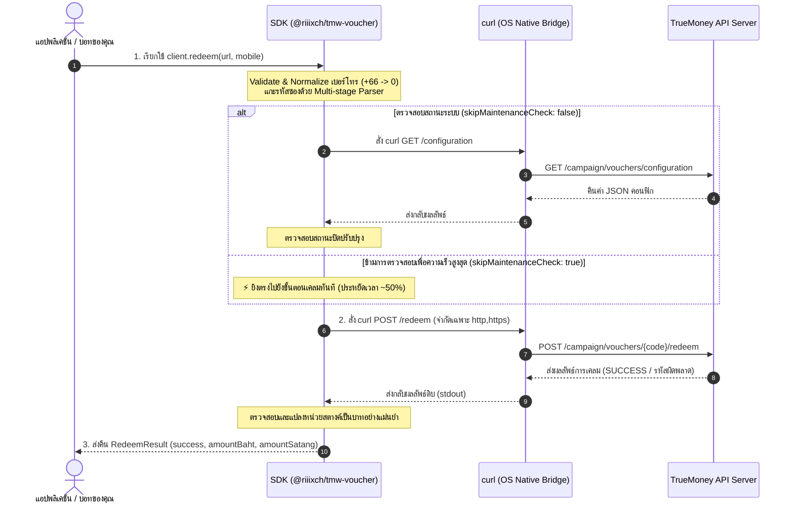

# 🇹🇭 @riiixch/tmw-voucher 🧧

[](https://www.npmjs.com/package/@riiixch/tmw-voucher)
[](https://nodejs.org)
[](https://www.typescriptlang.org)
[](https://github.com/riiixch/tmw-voucher/actions/workflows/ci.yml)
[](https://vitest.dev)
[](LICENSE)
[](#)
[](https://github.com/riiixch)

> **เครื่องมือและไลบรารีภาษา JavaScript/TypeScript คุณภาพสูงสำหรับกดรับซองอั่งเปา (Gift Voucher) ของ TrueMoney Wallet โดยอัตโนมัติ ออกแบบมาให้มีความทนทานและปลอดภัยระดับ Enterprise พร้อมระบบหลบเลี่ยง Cloudflare TLS Fingerprint โดยใช้ Native `curl` เป็นค่าเริ่มต้น และรองรับการดักจับข้อผิดพลาดอย่างละเอียด ปราศจาก Runtime Dependencies ภายนอก**
>
> 🔗 **ดูข้อมูลแพ็กเกจบน NPM Registry:** [@riiixch/tmw-voucher](https://www.npmjs.com/package/@riiixch/tmw-voucher)

---

## 💡 แก้ไขปัญหาอะไร? (What Problem Does This Solve?)

การเขียนโค้ดยิงกดรับซองอั่งเปาทรูมันนี่แบบดั้งเดิมมักพบปัญหาที่ทำให้บอทหรือเซิร์ฟเวอร์แครชบ่อยครั้ง SDK ตัวนี้ได้รับการออกแบบเพื่อแก้ปัญหาเชิงลึกทั้งหมด:

### 1️⃣ การบล็อก 403 Forbidden จาก Cloudflare TLS Fingerprint
- **ปัญหา**: TrueMoney วางหน้าแคมเปญแจกซองอั่งเปาไว้หลัง Cloudflare Bot Management ส่งผลให้ HTTP Client ใน Node.js ทั่วไป (เช่น `axios` หรือ `fetch`) ถูกตรวจจับ TLS Fingerprint และถูกปฏิเสธเป็น 403 Forbidden เสมอ
- **วิธีแก้**: SDK เชื่อมต่อคำขอผ่าน **Native `curl` Bridge** ของระบบปฏิบัติการโดยตรง ทำให้ Cloudflare จัดประเภทเป็นไคลเอนต์ปกติ จึงสามารถส่งคำขอได้อย่างราบรื่น 100%

### 2️⃣ ปัญหาเบอร์โทรศัพท์ขาเข้าที่ผิดรูปแบบ (Input Validation & Normalization)
- **ปัญหา**: เบอร์โทรศัพท์ของผู้รับเงินมักติดขีดแดช (`-`), ช่องว่าง, หรือส่งมาในรูปแบบรหัสโทรศัพท์ระหว่างประเทศ (เช่น `+66812345678` หรือ `66812345678`) หากส่งข้อมูลดิบจะถูก TrueMoney ปฏิเสธ
- **วิธีแก้**: มีระบบ **Early Constructor Validation & Normalization** สแกนและตรวจสอบรูปแบบเบอร์ทันทีตั้งแต่ขั้นตอนสร้าง Instance (`new TmwVoucher`) ล้างอักขระพิเศษ และแปลงรหัสสากล `+66` / `66` เป็น `0` นำหน้าอัตโนมัติ (เช่น `+66 81-234-5678` ➔ `0812345678`) หากไม่ถูกต้องจะโยน `TmwValidationError` ทันทีเพื่อป้องกัน Runtime Crash

### 3️⃣ ความปลอดภัยและการป้องกัน SSRF (Security Hardening)
- **ปัญหา**: การใช้กระบวนการภายนอกยิงคำขอ HTTP เสี่ยงต่อการโจมตีประเภท Protocol Downgrade หรือ Server-Side Request Forgery (SSRF) เช่น `file://` หรือ `gopher://`
- **วิธีแก้**: ติดตั้งการจำกัดโปรโตคอลอย่างเข้มงวดด้วย `--proto =http,https` ของ `curl` บังคับให้รับส่งข้อมูลผ่าน HTTP/HTTPS เท่านั้น พร้อมตั้ง `--connect-timeout 10` เพื่อป้องกันการค้างสะสมของการเชื่อมต่อเครือข่าย

### 4️⃣ ความเร็วสูงสุดในการรับซอง (Flash Voucher Claiming)
- **ปัญหา**: โดยปกติ SDK จะต้องส่งคำขอ 2 ครั้ง (ตรวจสอบ `/configuration` ก่อน แล้วจึงยิง `/redeem`) ทำให้เกิด Latency สองเท่าตัว ซึ่งอาจช้าเกินไปในสถานการณ์แจกซองด่วนที่มีการแย่งกดรับเงิน
- **วิธีแก้**: รองรับอ็อปชัน `skipMaintenanceCheck: true` เพื่อข้ามขั้นตอนตรวจเช็กคอนฟิกและยิงตรงเข้า API เคลมซองใน 1 Network Roundtrip ช่วยลดเวลาตอบสนองลงถึง ~50%

### 5️⃣ ความเปราะบางของเครือข่าย (Network Resilience & Exponential Backoff)
- **ปัญหา**: ในระบบโปรดักชัน บางครั้งเครือข่ายอาจมีความล่าช้า สัญญาณสะดุด หรือเซิร์ฟเวอร์ปลายทางมีภาระงานสูงชั่วคราว
- **วิธีแก้**: มีระบบ **Automatic Retry & Exponential Backoff** แบบ Native โดยไม่ต้องพึ่งไลบรารีภายนอก เมื่อการเชื่อมต่อล้มเหลว ระบบจะรอคอยและลองใหม่อัตโนมัติด้วยช่วงเวลาที่ทวีคูณ (เช่น 1s ➔ 2s ➔ 4s)

---

## 🌟 จุดเด่นของแพ็กเกจ (Key Features)

- **100% TypeScript & Strict Type Safety**: พัฒนาบน TypeScript 7.0+ พร้อมกำหนด Type ชัดเจน ไม่มีการใช้ `any` และมี Prototype Chain Recovery สำหรับ Error classes ครบถ้วน
- **Zero Runtime Dependencies**: ไม่พึ่งพาแพ็กเกจภายนอกในระบบรันไทม์ (Zero Dependencies) ปลอดภัย น้ำหนักเบา และลดความเสี่ยงด้าน Supply Chain
- **Dual Module Build (ESM & CJS)**: รองรับทั้ง ECMAScript Modules (`import`) และ CommonJS (`require`) พร้อม `.d.ts` และ `.d.cts` เต็มรูปแบบ
- **Enterprise Security**: ป้องกัน SSRF ด้วย `--proto =http,https` และควบคุม Timeout ในระดับเน็ตเวิร์ก
- **Granular Exception Handling**: แยกประเภทคลาสข้อผิดพลาดอย่างชัดเจน (`TmwValidationError`, `TmwInvalidUrlError`, `TmwMaintenanceError`, `TmwNetworkError`) สะดวกต่อการเขียน Logic ดักจับในระบบจริง

---

## 📊 ลำดับขั้นตอนการทำงาน (System Architecture & Sequence Flow)



---

## 📦 การติดตั้งและข้อกำหนดของระบบ (Installation & Prerequisites)

### ข้อกำหนดของระบบ (Prerequisites)
- **Node.js**: เวอร์ชั่น `>= 20.0.0`
- **เครื่องมือ `curl`**: ต้องมีคำสั่ง `curl` (หรือ `curl.exe` บน Windows) อยู่ใน System `PATH` เพื่อใช้ในการส่งคำขอบายพาส Cloudflare (Windows 10/11, macOS, และ Linux ส่วนใหญ่จะมีติดตั้งมาให้เป็นค่าเริ่มต้นแล้ว)

### คำสั่งติดตั้งผ่าน NPM
```bash
npm install @riiixch/tmw-voucher
```

---

## 🚀 คู่มือการใช้งาน (Usage Guide)

### 1️⃣ การใช้งานผ่าน Class (แนะนำสำหรับระบบทั่วไป)

```typescript
import { TmwVoucher } from '@riiixch/tmw-voucher';

// 1. สร้างอินสแตนซ์พร้อมระบุการตั้งค่า
const redeemer = new TmwVoucher({
  mobile: '+66 81-234-5678', // ระบบจะแปลงเป็น 0812345678 ให้โดยอัตโนมัติ
  timeout: 15000,            // หมดเวลารอคอย 15 วินาที
  retryOptions: {
    retries: 3,              // พยายามยิงซ้ำสูงสุด 3 ครั้งเมื่อเกิดข้อผิดพลาดทางเครือข่าย
    minTimeout: 1000,        // เวลารอคอยเริ่มต้น 1 วินาที
    factor: 2                // ทวีคูณเวลาเป็น 2 เท่าในแต่ละรอบ (1s -> 2s -> 4s)
  }
});

async function main() {
  try {
    const voucherUrl = 'https://gift.truemoney.com/campaign/?v=5a1b2c3d4e5f6g7h8i9j0k';
    const result = await redeemer.redeem(voucherUrl);

    if (result.success) {
      console.log(`🎉 แลกรับซองสำเร็จ!`);
      console.log(`- ได้รับเงิน: ${result.amountBaht} บาท (${result.amountSatang} สตางค์)`);
      console.log(`- ข้อความ: ${result.message}`);
    } else {
      console.error(`❌ แลกรับซองไม่สำเร็จ: [${result.code}] ${result.message}`);
    }
  } catch (error) {
    console.error('เกิดข้อผิดพลาดในการประมวลผล:', error);
  }
}

main();
```

---

### 2️⃣ การใช้งานโหมดความเร็วสูง (High-Speed Flash Claiming)

หากต้องการความเร็วสูงสุด เช่น ในการแข่งขันกดรับซองอั่งเปา สามารถเปิดใช้งาน `skipMaintenanceCheck: true` เพื่อลดรอบการยิง HTTP เหลือเพียงครั้งเดียว:

```typescript
import { TmwVoucher } from '@riiixch/tmw-voucher';

const flashRedeemer = new TmwVoucher({
  mobile: '0812345678',
  skipMaintenanceCheck: true // ⚡ ข้ามการตรวจสอบสถานะปิดปรับปรุง ยิงตรงเพื่อความเร็วสูงสุด
});

async function claimFast() {
  const result = await flashRedeemer.redeem('https://gift.truemoney.com/campaign/?v=5a1b2c3d4e5f6g7h8i9j0k');
  console.log(result.success ? `ได้รับเงิน: ${result.amountBaht} บาท` : `ไม่สำเร็จ: ${result.message}`);
}

claimFast();
```

---

### 3️⃣ การเรียกใช้แบบฟังก์ชันด่วน (Functional Wrapper)

หากต้องการความสะดวกและรวดเร็วโดยไม่ต้องสร้าง Instance สามารถใช้ฟังก์ชัน `redeemVoucher` ได้ทันที:

```typescript
import { redeemVoucher } from '@riiixch/tmw-voucher';

async function quickClaim() {
  // รองรับการส่งลิงก์ซองแบบดิบ หรือส่งเฉพาะรหัสซอง
  const result = await redeemVoucher(
    '0812345678',
    'https://gift.truemoney.com/campaign/?v=5a1b2c3d4e5f6g7h8i9j0k',
    { skipMaintenanceCheck: true } // สามารถส่ง Options เสริมได้
  );

  if (result.success) {
    console.log(`ยอดเงินโอนเข้ากระเป๋า: ${result.amountBaht} บาท`);
  } else {
    console.log(`เกิดความผิดพลาด: ${result.message}`);
  }
}

quickClaim();
```

---

## 🛡️ การจัดการข้อผิดพลาด (Granular Error Handling)

SDK นี้จำแนกคลาสข้อยกเว้นออกเป็นหมวดหมู่อย่างชัดเจน ทำให้สามารถเขียนเงื่อนไขดักจับเฉพาะกรณีได้อย่างแม่นยำ:

```typescript
import {
  TmwVoucher,
  TmwValidationError,
  TmwInvalidUrlError,
  TmwMaintenanceError,
  TmwNetworkError,
  TmwVoucherError
} from '@riiixch/tmw-voucher';

const redeemer = new TmwVoucher({ mobile: '0812345678' });

async function safeClaim(voucherUrl: string) {
  try {
    const result = await redeemer.redeem(voucherUrl);
    // จัดการผลลัพธ์ปกติ...
  } catch (error) {
    if (error instanceof TmwValidationError) {
      console.error('❌ เบอร์โทรศัพท์ไม่ถูกต้อง:', error.message);
    } else if (error instanceof TmwInvalidUrlError) {
      console.error('❌ ลิงก์ซองหรือรหัสไม่ถูกต้อง:', error.message);
    } else if (error instanceof TmwMaintenanceError) {
      console.error('⚠️ ระบบ TrueMoney กำลังปิดปรับปรุงชั่วคราว:', error.message);
    } else if (error instanceof TmwNetworkError) {
      console.error('🌐 การเชื่อมต่อเครือข่ายขัดข้อง หรือ cURL ล้มเหลว:', error.message);
    } else if (error instanceof TmwVoucherError) {
      console.error('💥 ข้อผิดพลาดทั่วไปของไลบรารี:', error.message);
    } else {
      console.error('❓ ข้อผิดพลาดที่ไม่คาดคิด:', error);
    }
  }
}
```

---

## ⚙️ การใช้งาน Custom Requester และ Proxy

หากต้องการทำงานบนสภาพแวดล้อมที่จำกัด (เช่น Cloudflare Workers หรือ Serverless ที่ไม่อนุญาตให้รัน `child_process`) หรือต้องการสวม Proxy / Custom HTTP Client สามารถส่งฟังก์ชัน `requester` ของคุณเองได้ หรือนำ `defaultCurlRequester` ไป Wrap เพื่อทำ Custom Logging ได้ตามต้องการ:

```typescript
import { TmwVoucher, RequesterFunction, defaultCurlRequester } from '@riiixch/tmw-voucher';

// ตัวอย่างการ Wrap defaultCurlRequester เพื่อบันทึก Access Log
const loggingRequester: RequesterFunction = async (url, options) => {
  const startTime = Date.now();
  console.log(`[REQ] ${options?.method || 'GET'} -> ${url}`);
  try {
    const response = await defaultCurlRequester(url, options);
    console.log(`[RES] สำเร็จในเวลา ${Date.now() - startTime}ms`);
    return response;
  } catch (err: any) {
    console.error(`[ERR] ล้มเหลวในเวลา ${Date.now() - startTime}ms:`, err.message);
    throw err;
  }
};

const client = new TmwVoucher({
  mobile: '0812345678',
  requester: loggingRequester
});
```

---

## 📘 ข้อมูลอ้างอิง API และ Type (API & Type References)

### ⚙️ 1. `TmwVoucherConfig`

```typescript
const client = new TmwVoucher(config?: TmwVoucherConfig);
```

| พารามิเตอร์ | ชนิดข้อมูล | ค่าเริ่มต้น | คำอธิบาย |
| :--- | :--- | :---: | :--- |
| `mobile` | `string` | - | เบอร์โทรศัพท์ 10 หลักของผู้รับเงิน (ทำการ Normalize และ Validate อัตโนมัติใน Constructor) |
| `timeout` | `number` | `15000` | ระยะเวลารอคอยสูงสุดในหน่วยมิลลิวินาที (15 วินาที) |
| `requester` | `RequesterFunction` | `defaultCurlRequester` | ฟังก์ชันส่งคำขอข้อมูล HTTP (สามารถแทนที่ด้วย Custom Requester ได้) |
| `retryOptions` | `RetryOptions` | - | การตั้งค่าการพยายามส่งคำขอซ้ำเมื่อเกิดปัญหาเน็ตเวิร์ก (Automatic Retry) |
| `skipMaintenanceCheck` | `boolean` | `false` | ข้ามการตรวจสอบ `/configuration` ก่อนเคลมซอง เพื่อลด Latency เหลือ 1 Roundtrip (~50% เร็วขึ้น) |

---

### 🏷️ 2. `RetryOptions`

| พารามิเตอร์ | ชนิดข้อมูล | ค่าเริ่มต้น | คำอธิบาย |
| :--- | :--- | :---: | :--- |
| `retries` | `number` | `0` | จำนวนครั้งสูงสุดที่จะลองใหม่เมื่อเกิดความผิดพลาดจากการเชื่อมต่อ (`0` คือไม่ลองใหม่) |
| `minTimeout` | `number` | `1000` | ระยะเวลาที่รอก่อนลองใหม่ในครั้งแรกสุด (หน่วยมิลลิวินาที) |
| `factor` | `number` | `2` | ตัวคูณการหน่วงเวลาแบบ Exponential Backoff ในรอบถัดไป (เช่น 1s ➔ 2s ➔ 4s) |

---

### 🏷️ 3. `RedeemResult`

| ฟิลด์ | ชนิดข้อมูล | ปรากฏเมื่อ | คำอธิบาย |
| :--- | :--- | :---: | :--- |
| `success` | `boolean` | เสมอ | ระบุว่าทำรายการเคลมเงินสำเร็จหรือไม่ |
| `amountBaht` | `number` | `success: true` | **ยอดเงินรวมที่ได้รับจริงในหน่วยบาท** (มีทศนิยมสูงสุด 2 ตำแหน่ง) |
| `amountSatang` | `number` | `success: true` | ยอดเงินรวมที่ได้รับในหน่วยสตางค์ (จำนวนเต็ม เช่น `1550` = 15.50 บาท) |
| `code` | `string` | `success: false` | รหัสสถานะผิดพลาดทางธุรกิจจาก TrueMoney API เช่น `VOUCHER_OUT_OF_STOCK` |
| `message` | `string` | เสมอ | ข้อความอธิบายผลลัพธ์จาก TrueMoney Wallet API |

---

### 📁 4. คลาสข้อผิดพลาด (Custom Exceptions)

ทุกคลาสสืบทอดมาจากคลาสแม่ **`TmwVoucherError`**:

| คลาสข้อผิดพลาด | สาเหตุที่เกิดขึ้น |
| :--- | :--- |
| `TmwValidationError` | ข้อมูลนำเข้าไม่ถูกต้อง (เช่น เบอร์โทรศัพท์ไม่ใช่ 10 หลัก หรือระบุค่าว่าง) ดักตรวจตั้งแต่ Constructor |
| `TmwInvalidUrlError` | รูปแบบลิงก์หรือรหัสซองอั่งเปาไม่ถูกต้อง หรือไม่พบรหัสซองที่ใช้งานได้ |
| `TmwMaintenanceError` | ระบบ API แคมเปญแจกซองของ TrueMoney กำลังปิดปรับปรุงชั่วคราว |
| `TmwNetworkError` | เกิดปัญหาการเชื่อมต่อ หรือคำสั่ง cURL ล้มเหลวหลังจากลองใหม่ครบตามโควตาแล้ว |
| `TmwVoucherError` | คลาสข้อยกเว้นระดับรากฐานของไลบรารี ใช้สำหรับดักจับข้อผิดพลาดทั้งหมดของแพ็กเกจ |

---

### 🧩 5. ฟังก์ชันและยูทิลิตี้เสริมที่ Export ออกมา

- **`redeemVoucher(mobileNumber, voucherUrlOrCode, options?)`**: ฟังก์ชันสำหรับเคลมซองโดยไม่ต้องสร้าง Class
- **`extractVoucherCode(urlOrCode)`**: ยูทิลิตี้สกัดรหัสซองอั่งเปา 10-48 หลักจาก URL หรือสตริงใดๆ รองรับอักขระแปลกปลอมและ query parameters
- **`defaultCurlRequester(url, options?)`**: ฟังก์ชันส่ง HTTP ผ่าน Native cURL Bridge เริ่มต้นของไลบรารี

---

## 🛠️ คำสั่งสำหรับนักพัฒนา (Development & Testing)

หากต้องการร่วมพัฒนา ปรับแต่ง หรือทดสอบชุดคำสั่งภายในคลังโค้ดนี้:

```bash
# ตรวจสอบความถูกต้องของ Type ทั้งโปรเจกต์ (TypeScript 7.0+)
npm run typecheck

# รันชุดทดสอบทั้งหมดด้วย Vitest (22 unit tests)
npm run test

# รันชุดทดสอบแบบ Watch Mode ระหว่างพัฒนา
npm run test:watch

# คอมไพล์โปรเจกต์ (tsup Dual CJS/ESM + TypeScript type declarations)
npm run build
```

---

## 👥 ผู้พัฒนา (Developer Credit)

- **RIIIXCH** (Developer & Creator)
  - **GitHub Profile:** [@riiixch](https://github.com/riiixch)
  - **GitHub Repository:** [tmw-voucher](https://github.com/riiixch/tmw-voucher)

---

## 📄 ใบอนุญาต (License)

แพ็กเกจนี้เผยแพร่ภายใต้ใบอนุญาตแบบ **[ISC License](LICENSE)** — สงวนลิขสิทธิ์ © 2026 RIIIXCH
